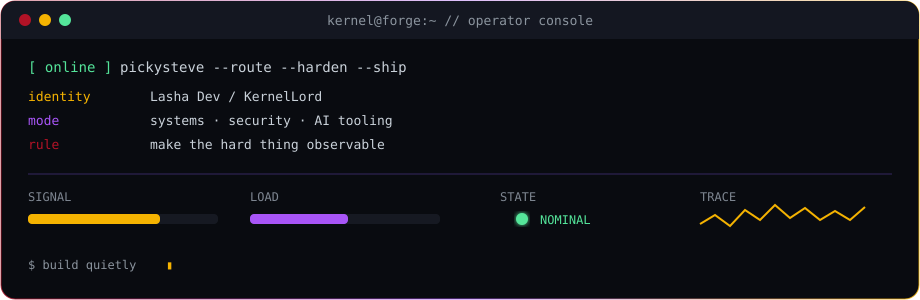
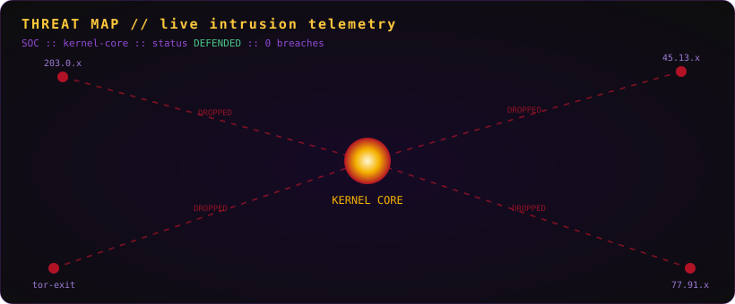

<!-- KernelLord · profile repository · built for systems that survive contact with reality -->

  

  
  
  

## `whoami`

I’m **Lasha Dev** — a systems builder working where **automation, security, developer tooling, and AI** meet.

I like software with a pulse: fast paths you can explain, protocols you can inspect, automation you can trust, and interfaces that make complex systems feel inevitable.

> **Build quietly. Understand deeply. Ship what survives.**

  

## `operator_console`

  

- **Systems:** Rust, Linux, async architectures, performance, and the layers most people skip.
- **Security:** secure defaults, attack-surface reduction, prompt-injection resistance, and making failure legible.
- **AI tooling:** practical agent workflows, context routing, and developer tools that stay out of the way.
- **Operating principle:** no magic boxes — if it matters, trace it, test it, and make it observable.

## `active_build`

  

### [Pickysteve](https://github.com/KernelLord/pickysteve)

A skill router and context picker for Claude Code, Cursor, and Aider. It chooses the right skill for each prompt while filtering prompt-injection patterns before they reach the tool layer.

`PYTHON` · `AI AGENTS` · `MCP` · `PROMPT SECURITY`

[**Open Pickysteve →**](https://github.com/KernelLord/pickysteve)

## `stack --loaded`

  

  
   
  

## `kernel_principles`

  

| Principle | Implementation |
|---|---|
| **Observe first** | Logs, traces, metrics, and readable failure modes before clever abstractions. |
| **Least privilege** | Small surfaces, explicit boundaries, and no trust granted by accident. |
| **Automate the boring** | Let tools handle repetition so attention stays on the hard edge of the problem. |
| **Ship the proof** | A working artifact beats a dramatic claim. |

## `activity --watch`

  

  <picture>
    <source media="(prefers-color-scheme: dark)" srcset="https://raw.githubusercontent.com/KernelLord/KernelLord/output/github-snake-dark.svg" />
    <source media="(prefers-color-scheme: light)" srcset="https://raw.githubusercontent.com/KernelLord/KernelLord/output/github-snake.svg" />
    
  </picture>

  

## `connect`

If you’re building something that needs to be **fast, secure, observable, or difficult to break**, [open an issue](https://github.com/KernelLord/KernelLord/issues).

  

