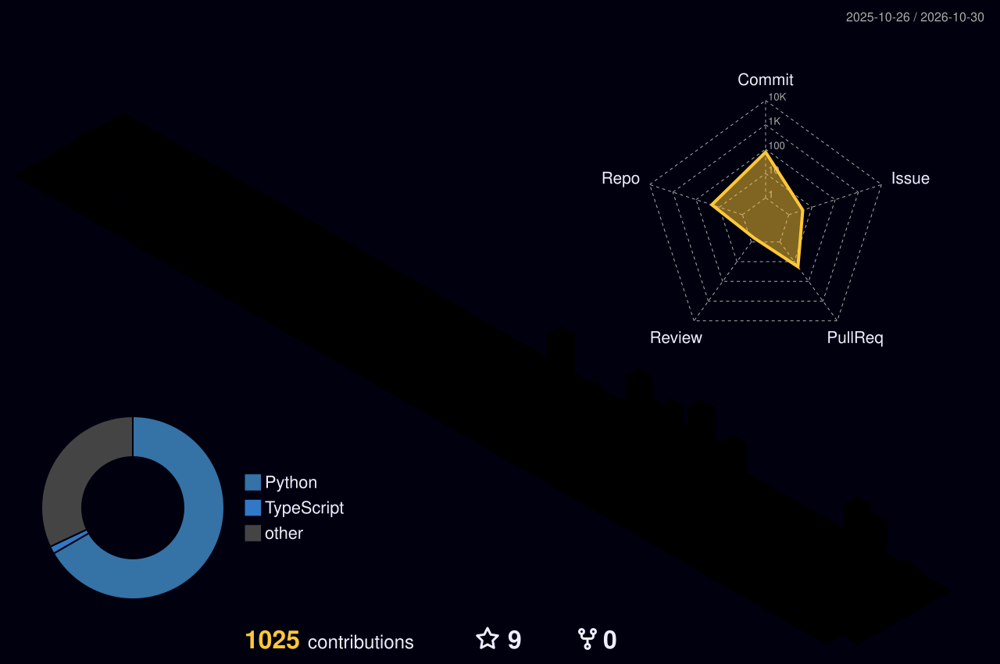

<!-- KernelLord profile README -->

  

  
  
  

  

## `whoami`

I’m **Lasha Dev**, a systems builder working where **automation, security, developer tooling, and AI** meet.

I care about fast paths you can explain, protocols you can inspect, automation you can trust, and tools that make hard work feel obvious.

## `active_build`

  

### [Pickysteve](https://github.com/KernelLord/pickysteve)

A skill router and context picker for Claude Code, Cursor, and Aider. It chooses the right skill for each prompt and filters prompt injection patterns before they reach the tool layer.

`PYTHON` · `AI AGENTS` · `MCP` · `PROMPT SECURITY`

[**Open Pickysteve**](https://github.com/KernelLord/pickysteve)

## `stack --loaded`

  

## `signal`

  

  

## `telemetry`

  
  

  

## `contribution_matrix`

  <picture>
    <source media="(prefers-color-scheme: dark)" srcset="https://raw.githubusercontent.com/KernelLord/KernelLord/output/github-snake-dark.svg" />
    <source media="(prefers-color-scheme: light)" srcset="https://raw.githubusercontent.com/KernelLord/KernelLord/output/github-snake.svg" />
    
  </picture>

  

## `connect`

If you’re building something that needs to be **fast, secure, observable, or difficult to break**, [open an issue](https://github.com/KernelLord/KernelLord/issues).

