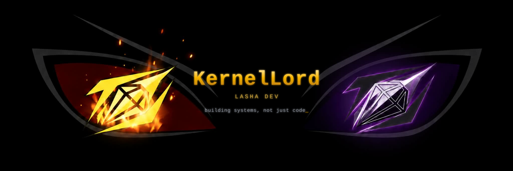

<!--
  KernelLord · Lasha Dev · GitHub Profile README
  Gold #F5B301 / #FFC83D · Purple #A855F7 / #8B5CF6
  Crimson #B11226 · Background #0D0D0D
  Focus: Systems Engineering · Rust · Cybersecurity · AI
-->
<!-- HERO -->

<!-- INTRODUCTION -->

I build and explore systems with an emphasis on performance, reliability, and security.

My interests span Rust, low-level engineering, Linux, cybersecurity, asynchronous systems, and AI. I care about understanding how things work beneath the surface — from network protocols and operating systems to application architecture and infrastructure.

<!-- REPOSITORIES -->

> repositories

<!-- CURRENT WORK -->

⚡ Currently in the forge

Private builds. Public ambition.

Exploring systems programming, security engineering, automation, and the boundaries of what’s possible with software.

Build quietly. Understand deeply. Ship when it’s ready.

<!-- TECHNOLOGY STACK -->

> stack

languages

systems · infrastructure

ai · machine learning

offensive security

<!-- SKILLS RADAR -->

> ./radar --scan

<!-- CONTRIBUTION SNAKE -->

> contribution_graph --animate

<picture>
  <source media="(prefers-color-scheme: dark)" srcset="https://raw.githubusercontent.com/KernelLord/KernelLord/output/github-snake-dark.svg" />
  <source media="(prefers-color-scheme: light)" srcset="https://raw.githubusercontent.com/KernelLord/KernelLord/output/github-snake.svg" />
  
</picture>

<!-- CONTRIBUTION STREAK -->

> systems_log

<!-- FOOTER -->

