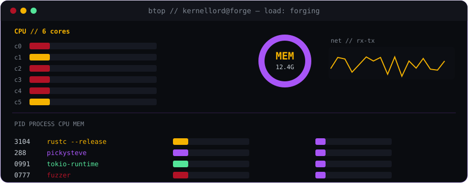

<!-- KernelLord · profile repository · built for systems that survive contact with reality -->

  

  
  
  

## `whoami`

I’m **Lasha Dev** — a systems builder working where **Rust, security, infrastructure, and AI** meet.

I like software with a pulse: fast paths you can explain, protocols you can inspect, automation you can trust, and interfaces that make complex systems feel inevitable. This is the public command center for that work.

> **Build quietly. Understand deeply. Ship what survives.**

  

## `current_mission`

  

- **Systems:** Rust services, async architectures, Linux, performance, and the layers most people skip.
- **Security:** offensive thinking, threat modeling, secure defaults, and making attack surfaces legible.
- **AI infrastructure:** practical agent tooling, context engineering, retrieval, and the control plane around models.
- **Operating principle:** no magic boxes — if it matters, trace it, test it, and make it observable.

## `featured_builds`

| Build | What it does | Signal |
|---|---|---|
| [**turbogem-backend**](https://github.com/KernelLord/turbogem-backend) | Hardened Rust backend with Axum, Argon2id, and ML-KEM-768 post-quantum cryptography. | `RUST` `SECURITY` `PQC` |
| [**pickysteve**](https://github.com/KernelLord/pickysteve) | Skill router and context picker for Claude Code, Cursor, and Aider, with prompt-injection filtering for MCP. | `PYTHON` `AI` `MCP` |
| [**awesome-secure-mcp-servers**](https://github.com/KernelLord/awesome-secure-mcp-servers) | A curated map of MCP servers with security validation through an MCP scanning pipeline. | `SECURITY` `RESEARCH` |
| [**turbogem-audit**](https://github.com/KernelLord/turbogem-audit) | Architecture blueprint, code-review findings, audit archive, and improvement roadmap for TurboGem. | `AUDIT` `ARCHITECTURE` |

[**Browse every repository →**](https://github.com/KernelLord?tab=repositories)

## `stack --loaded`

  

  
   
  

## `threat_model`

  

I’m interested in the seam between capability and control: secure agent systems, resilient backends, protocol design, developer tooling, and the places where a single assumption can become an exploit.

## `activity --watch`

  

  <picture>
    <source media="(prefers-color-scheme: dark)" srcset="https://raw.githubusercontent.com/KernelLord/KernelLord/output/github-snake-dark.svg" />
    <source media="(prefers-color-scheme: light)" srcset="https://raw.githubusercontent.com/KernelLord/KernelLord/output/github-snake.svg" />
    
  </picture>

  

## `connect`

If you’re building something that needs to be **fast, secure, observable, or difficult to break**, [open an issue](https://github.com/KernelLord/KernelLord/issues).

  

